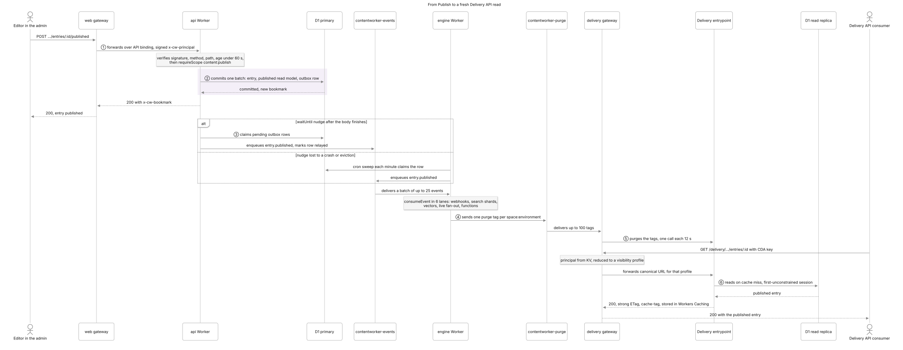

# Reference architecture

contentworker is a headless CMS that runs entirely on Cloudflare. Each customer gets an isolated
deployment: five Workers split by traffic profile, one D1 database as the system of record, and
R2, KV, Queues, Durable Objects, Workflows, Vectorize, Workers AI through AI Gateway, Images and
Stream around it. Writes commit to the D1 primary with an outbox row in the same batch, and
everything downstream (webhooks, search, cache purges, the media gate) follows from the event
queue the outbox feeds. Reads never touch the primary: the Delivery and media Workers answer from
Workers Caching, keyed so that readers with equal permissions share one cached body, and fall back
to D1 read replicas.

This page is for engineers who operate, extend or review contentworker, and for agents reading
these docs over MCP. It shows the whole deployment in one reference diagram, then develops the
three paths that matter most: publishing, public reads and assets. Each diagram has numbered
callouts explained in the text, and the text is a complete equivalent of the picture. For how
the code is layered, see [Architecture](./architecture.md); this page is about the runtime.

Shapes and line weights mean the same thing in every diagram. The diagrams are grey, with one
purple accent, and follow the reader's light or dark setting. A rectangle is a Worker or entrypoint
contentworker owns. A cylinder is durable state (D1, KV, R2, a queue, a Durable Object's storage,
an index). A stadium with a dashed border is a client or a Cloudflare service contentworker calls
but does not run (Workers AI, Images, Stream). A double-bordered box is a step detailed elsewhere.
Purple, with a bold label, marks the one or two nodes each diagram is about. A subgraph is a boundary: the customer
deployment, or the line between what is publicly routed and what is reachable only from inside
the Worker.

## The deployment

<picture>
  <source media="(prefers-color-scheme: dark)" srcset="./diagrams/reference-architecture/overview.dark.svg">
  
</picture>

_Figure: A contentworker deployment, with numbered callouts. Source: [`overview.mmd`](./diagrams/reference-architecture/overview.mmd)._

**Question:** How do requests and data move through a contentworker deployment?
**Detail:** faithful (22 labeled nodes, budget 24). **Focus:** the D1 primary and the
`contentworker-events` queue, where every write lands and from which everything downstream
follows.

Each customer gets its own deployment (`deployments/<id>.jsonc`, rendered by `scripts/fleet.ts`)
with its own D1, R2, KV, Vectorize index, queues, AI Gateway and Workers. Inside it, the Workers
are split by traffic profile. Four are publicly routed and verify every credential they receive:
`web` at `<domain>`, `api` at `api.<domain>`, `delivery` at `cdn.<domain>` and `media` at
`media.<domain>`. The rest have no public route: the `engine` Worker, the Durable Objects and
Workflows it hosts, and the cached `Delivery` and `Media` entrypoints.

1. **Admin users sign in at `<domain>`.** The `web` Worker serves the React Router admin and
   handles human authentication: passwords, passkeys, TOTP, OIDC and SCIM. It reads its auth
   tables from the same D1 database.
2. **web forwards to the api over the `API` service binding.** For a signed-in session, the
   gateway strips cookies and adds `x-cw-principal`, signed with HMAC-SHA256 under
   `PRINCIPAL_KEY`. The signature is bound to the exact method and path and is valid for 60
   seconds. The api trusts the header only when the signature holds. Bearer calls to
   `/delivery/*` go to the delivery Worker over the `DELIVERY` binding instead, so they get the
   same cache as the `cdn.` host.
3. **API and MCP agents call the api directly** at `api.<domain>` with API keys, personal access
   tokens or OAuth tokens. Every capability is one use-case exposed through both REST and MCP.
4. **The api commits each write as one unit of work.** A use-case reads everything first, then
   commits one D1 batch to the primary: the aggregate, the published read model and the outbox
   row. The response carries `x-cw-bookmark` for read-your-writes.
5. **The api relays the outbox in `waitUntil`.** Once the response body finishes, the api moves
   pending outbox rows onto `contentworker-events`. The engine's per-minute cron sweep relays
   anything the nudge missed.
6. **The engine consumes events.** It runs `consumeEvent` in six ordered lanes, which covers
   webhooks, functions, search shards and vectors, live fan-out, KV cache tags and agent jobs. It
   reads and writes the D1 primary as it goes.
7. **The engine enqueues purge tags.** It sends one coalesced message per touched
   space:environment to `contentworker-purge`, and asset tags to `contentworker-media-purge`.
   Workers Caching is per Worker, so delivery and media each drain their own queue at most one
   purge call every 12 seconds.
8. **Public consumers read with CDA or CPA keys** at `cdn.<domain>`. The delivery gateway is
   uncached and authenticates every request. It reads the principal from `KV_CACHE`, so the
   steady state reads no database.
9. **The gateway forwards a canonical URL per visibility profile** to the cached `Delivery`
   entrypoint. Readers with equal profiles share one cache entry. On a miss, `Delivery` reads a
   D1 read replica.
10. **Only the engine writes the media gate.** On `asset.published`, `asset.unpublished` and
    `asset.deleted`, `syncAssetGate` writes or removes `asset-gate:<space>:<env>:<id>` in
    `KV_CACHE` from the current published snapshot.
11. **Readers fetch published files** at `media.<domain>`. The media gateway checks the URL's
    token and forwards a canonical URL to the cached `Media` entrypoint. On a miss, `Media` reads
    the gate, then the bytes from R2, and gets resized variants from Images. Share links (`/s/<space>/<env>/<link>/<token>`) take the same
    gateway: it checks the token, then the link on every request, and renders the page in `Media`.
12. **Uploads land in R2 and start ingest.** The api's signed `PUT` stores the bytes. R2's
    object-create notification feeds `contentworker-asset-events`, and the engine starts one
    `AssetIngestWorkflow` per file version. The workflow calls Workers AI through AI Gateway and
    writes embeddings to Vectorize. Files past 100 MiB upload in parts through R2 multipart and start ingest the same way on completion. The api also creates Stream direct uploads for video. A zip download is a fourth Workflow, `AssetZipWorkflow` (`ASSET_ZIP_WF`), started from `asset_zip.requested` and writing the archive to R2 one 8 MiB part per step.
13. **api and delivery reach the engine's classes through `script_name` bindings.** The api binds
    `LiveHubDO`, `RateLimiterDO`, `CostGuardDO`, `SearchShardDO` and `AssistantAgent`, plus the
    `AgentWorkflow` and `EditorialWorkflow` workflows. The delivery Worker binds `LiveHubDO` and
    `SearchShardDO`.

**Left out on purpose.** Some things stay out of the overview to keep it within its node budget,
and they are listed here instead:

- The binding matrix below. It is a table, and it would add about 25 edges to the diagram.
- `RateLimiterDO` and `AssistantAgent` in the Durable Objects label.
- The `contentworker-bulk` and `contentworker-agents` queues and every dead-letter queue.
- Analytics Engine (`METRICS`), Worker Loader (`PLUGIN_LOADER`) and Email Sending.
- The Workers Rate Limiting bindings.
- `apps/docs`.
- The api's own delivery routes, which the admin uses for compare, search and live.
- The engine's cron jobs other than the outbox sweep.

### Which Worker binds what (from `apps/*/wrangler.jsonc`)

| Binding                                          |        web        |                     api                     |               delivery                |         media          |                         engine                         |
| ------------------------------------------------ | :---------------: | :-----------------------------------------: | :-----------------------------------: | :--------------------: | :----------------------------------------------------: |
| D1 `DB`                                          | yes (auth tables) |                     yes                     |        yes (replica sessions)         | yes (replica sessions) |                          yes                           |
| KV `KV_CACHE`                                    |                   |                     yes                     |                  yes                  |          yes           |                          yes                           |
| R2 `MEDIA_BUCKET`                                |                   |                     yes                     |                  yes                  |          yes           |                          yes                           |
| Vectorize `VECTORIZE`                            |                   |                     yes                     |                  yes                  |                        |                          yes                           |
| Workers AI `AI` (AI Gateway via `AI_GATEWAY_ID`) |                   |                     yes                     |                  yes                  |                        |                          yes                           |
| Images `IMAGES`                                  |                   |                     yes                     |                                       |          yes           |                          yes                           |
| Stream `STREAM`                                  |                   |                     yes                     |                                       |                        |                          yes                           |
| Worker Loader `PLUGIN_LOADER`                    |                   |                     yes                     |                                       |                        |                          yes                           |
| Service bindings                                 | `API`, `DELIVERY` |                                             |                                       |                        |                                                        |
| Durable Objects                                  |                   |             5, by `script_name`             | `LIVE_HUB`, `SEARCH` by `script_name` |                        |                       owns all 5                       |
| Workflows                                        |                   | `AGENT_WF`, `EDITORIAL_WF` by `script_name` |                                       |                        |           owns all 4, adds `ASSET_INGEST_WF`, `ASSET_ZIP_WF`    |
| Queue producer                                   |                   |     events, bulk, agents, asset-events      |                                       |                        | events, bulk, agents, purge, media-purge, asset-events |
| Queue consumer                                   |                   |                                             |             purge (+ DLQ)             |  media-purge (+ DLQ)   |      events, bulk, agents, asset-events (+ DLQs)       |

## Publish to deliver

<picture>
  <source media="(prefers-color-scheme: dark)" srcset="./diagrams/reference-architecture/publish-to-deliver.dark.svg">
  
</picture>

_Figure: From Publish to a fresh Delivery API read. Source: [`publish-to-deliver.mmd`](./diagrams/reference-architecture/publish-to-deliver.mmd)._

**Question:** What happens between Publish and a fresh Delivery API read?
**Detail:** balanced (11 participants, budget 12). **Focus:** the one D1 batch that commits the
entry and its outbox row together (the shaded block).

This is a sequence diagram because the point is ordering across eleven participants, including
one branch: the nudge, or the cron sweep that covers for it. A flowchart would lose the order.

1. **The editor publishes.** `POST /spaces/:space/environments/:env/entries/:id/published` reaches
   the web gateway, which forwards it over the `API` binding with a signed `x-cw-principal`. The
   api checks the signature, method, path and age, then `requireScope` `content:publish`.
2. **One unit of work.** `publishEntry` reads first, then commits one D1 batch to the primary. The
   batch holds the entry, its published read model and an `entry.published` outbox row. Either
   all of it commits or none of it does. The api answers `200` with `x-cw-bookmark`.
3. **The outbox is relayed.** In `waitUntil`, after the response body finishes, `drainOutbox`
   claims pending rows, enqueues them onto `contentworker-events` and marks them relayed, all in
   one unit. If the isolate dies first, the engine's per-minute cron sweep relays the row. The
   relay is at-least-once, so consumers are idempotent.
4. **The engine consumes and plans purges.** The consumer takes batches of up to 25 and runs
   `consumeEvent` in six lanes, keeping one entry's events in order. It then sends one coalesced
   purge message per space:environment touched by a purging event to `contentworker-purge`.
5. **The delivery Worker purges.** Its queue consumer drains up to 100 tags per call, at most one
   call every 12 seconds, and calls `Delivery.purge(tags)`. Workers Caching scopes the purge to
   that entrypoint.
6. **The next read refills the cache.** The gateway authenticates the key from KV, reduces it to
   a visibility profile and forwards the canonical URL. The cache misses, so `Delivery` reads a D1
   replica (`first-unconstrained`) and answers with a strong ETag and a `cache-tag` for the
   environment. Workers Caching stores the response with
   `public, max-age=60, stale-while-revalidate=86400`.

**Left out on purpose.** Webhooks, search, vector and live fan-out are collapsed into one note,
because they run in the engine and do not change the read. Also left out: the
`entry:beforePublish` hook, the optional moderation gate, KV delivery-cache tag invalidation, and
the agents queue.

## Delivery read path

<picture>
  <source media="(prefers-color-scheme: dark)" srcset="./diagrams/reference-architecture/delivery-read.dark.svg">
  
</picture>

_Figure: How a Delivery API request is authenticated and cached. Source: [`delivery-read.mmd`](./diagrams/reference-architecture/delivery-read.mmd)._

**Question:** How is a public Delivery API request authenticated and cached?
**Detail:** balanced (11 labeled nodes, budget 12). **Focus:** the visibility profile and the
Workers Caching entry keyed by it. Together they let equal readers share a cached body while
authorization still runs on every request.

This is a flowchart because the answer is a set of branches: rate limit, KV hit or miss, cache hit
or miss, and conditional request. The subgraphs draw the trust boundary between the publicly
routed gateway and the internal entrypoint.

1. **Rate limit first.** The uncached gateway, which is the default entrypoint, limits each client
   IP to 1200 requests a minute (`RATE_LIMIT_READ`). Over the limit, it answers `429` with
   `retry-after: 60`.
2. **Authenticate on every request.** `authenticateCached` reads the principal from `KV_CACHE` by
   the key's peppered hash, never by the token itself. Only on a KV miss does it look the key up on
   a D1 read replica. It then caches the principal for up to 60 seconds, tagged `principals:<space>`.
   Any key or role change in the space drops every cached principal of that space. A bad key gets
   a `401`, which is never cached.
3. **Reduce to a visibility profile.** The profile is a SHA-256 over the space, key kind, sorted
   scopes and content grants, and nothing else. The gateway builds
   `https://delivery.internal/_p/<profile>/<path>?<sorted query>` and passes the principal in an
   internal header (`x-cw-delivery-principal`). The cached entrypoint can trust that header only
   because nothing outside the Worker can reach it.
4. **A cache hit is shared.** Workers Caching, enabled only on the `Delivery` entrypoint with
   `cross_version_cache`, returns the body that every reader with the same profile shares.
5. **A miss reads a replica.** `Delivery` runs the same delivery routes the api mounts, against a
   D1 replica session (`first-unconstrained`). A `200` gets a strong ETag and a `cache-tag` for the
   path's environment and the environment it resolves to, so an alias repoint purges it too.
   Errors and empty answers are `no-store`.
6. **Conditional requests are answered at the gateway.** If `If-None-Match` names the cached
   ETag, the gateway answers `304`. Otherwise it streams the body with `vary: authorization`. The
   entrypoint always returns the full body, because a `304` stored in the cache would be an empty
   answer.

**Left out on purpose.** The live SSE stream and `/graphiql/*`, which the gateway answers itself.
GraphQL `POST`, which is served uncached with `private, no-store`. Purge, which is in diagram 2.
The client-facing `cache-control` rewrite.

## Asset pipeline

<picture>
  <source media="(prefers-color-scheme: dark)" srcset="./diagrams/reference-architecture/asset-pipeline.dark.svg">
  
</picture>

_Figure: From upload to a file served at media.&lt;domain&gt;. Source: [`asset-pipeline.mmd`](./diagrams/reference-architecture/asset-pipeline.mmd)._

**Question:** How does an uploaded asset become a served file at `media.<domain>`?
**Detail:** balanced (12 labeled nodes, budget 12). **Focus:** `AssetIngestWorkflow` and the KV
media gate, the two places an asset changes state on its way to being servable.

This is a flowchart with two boundaries. The engine is the only writer of the gate, and the media
Worker is the only reader that serves bytes. Ingest is asynchronous and fans out to four
services, and serving branches on the gate. A sequence diagram would have to pick one path.

1. **Bytes land in R2.** `createAsset` returns a signed `PUT /media/<key>` URL. It is signed with
   HMAC under `MEDIA_SIGNING_SECRET`, expires in 15 minutes and is bound to the content type.
   A single `PUT` takes at most 100 MiB (larger files go in parts), and the api stores the bytes in `MEDIA_BUCKET`.
2. **Two triggers, one run.** R2's object-create notification, created by `scripts/provision.sh`,
   sends a message to `contentworker-asset-events`. The api's signed `PUT` also enqueues an
   R2-shaped message there when it succeeds. The engine starts the run under
   `assetIngestInstanceId(scope, assetId, version, { etag })`, so both triggers and any
   redelivery start exactly one run per file version.
3. **Ingest steps.** Each step is a `step.do`, runs as one unit of work, and re-checks the version.
   The steps are:
   - `hash`: SHA-256 streamed from R2, with duplicate detection.
   - `probe` and `placeholder`: the Images binding's `info`, and a ThumbHash plus dominant colour.
   - `alt-text` and `tags`: Workers AI through AI Gateway, under the AI budget.
   - `extract-text`: `toMarkdown` for documents, Whisper for audio.
   - `embed` and `index`: the asset corpora's Vectorize namespace and `SearchShardDO` shards.
   - `finish`: writes `ingest_status` in D1.
4. **Publishing commits the snapshot.** Publishing an asset commits its published snapshot and an
   `asset.published` outbox row in one unit. The row is relayed to the engine like any other
   event.
5. **Only the engine writes the gate.** `syncAssetGate` reads the current published snapshot and
   writes `{v, r2Key, contentType, fileName, focal, expiresAt}` to `KV_CACHE`, or removes the
   entry. Because it reads the snapshot instead of trusting the event, a redelivered event
   converges. A revocation is purged again after 90 seconds, past KV's 60-second read cache and
   replica lag.
6. **A reader requests a published URL:**
   `/<space>/<env>/<assetId>/v<n>/<token>/<variant>/<fileName>`. The token is an HMAC over the
   space, environment, asset id and version.
7. **The gateway checks the token and negotiates the format.** It trusts no header. A bad token
   gets `404` before any cache, KV or D1 read. For a variant, it picks AVIF, WebP or the source
   format from `Accept` and adds `Vary: Accept`. It forwards one canonical
   `https://media.internal` URL, carrying only a single byte range and `If-Range`.
8. **Signed draft reads skip the cache.** Preview's short-lived `/media/<key>?exp=…&sig=…` GETs
   are served straight from R2, uncached. The gateway never accepts an upload here, and never a
   URL without an expiry.
9. **On a miss, `Media` asks the gate.** It checks the token again and reads the gate, falling
   back to a D1 replica. It then applies `mediaServability`: `404` for an unknown asset, version or
   file, and `410` past `expiresAt`. It serves the original from R2 or a variant transformed by
   Images, as `public, max-age=31536000, immutable`, or only until the asset's rights expire.

**Left out on purpose.**

- Stream video. Playback is public and never gated.
- The `contentworker-media-purge` queue, which is shown in the overview.
- `Media.range` RPC for byte ranges on uncached originals.
- The abandoned-upload sweep, reingest and the `asset_reindex` bulk job.
- Asset deletion and the cleanup of an environment's gate entries.

## Use case to solution

| Need                                                 | Solution                                                                                                            | Caveat                                                                                                                                    |
| ---------------------------------------------------- | ------------------------------------------------------------------------------------------------------------------- | ----------------------------------------------------------------------------------------------------------------------------------------- |
| One system of record for content, users and settings | D1, with every write a single unit of work (`withTransaction`)                                                      | One writer per database and 100 bound parameters per statement; see [Consistency](./consistency.md)                                       |
| Downstream work that never loses an event            | A transactional outbox relayed to Queues, with a cron sweep behind the `waitUntil` nudge                            | At-least-once: every consumer is idempotent                                                                                               |
| Public reads that scale without a database read      | The delivery gateway authenticates from KV; Workers Caching keyed by visibility profile; D1 read replicas on a miss | A cached body stays until its purge lands, and purges are paced at one call every 12 s; see [Events & webhooks](./events-and-webhooks.md) |
| Admin and agents with the same capabilities          | One use-case layer exposed through REST and MCP on the api Worker                                                   | The web Worker's signed `x-cw-principal` is the only trusted header, and only on the api                                                  |
| Asset processing that survives retries               | One `AssetIngestWorkflow` per file version, keyed by a deterministic instance id                                    | Two triggers (R2 notification and the api's upload) collapse to one run                                                                   |
| Published files on a long-lived cache                | The media Worker serves immutable URLs; only the engine writes the KV gate                                          | Revocation waits out KV's 60 s read cache, so the engine purges again after 90 s                                                          |
| Search and AI features within budget                 | Workers AI through AI Gateway, Vectorize, `SearchShardDO` and the `CostGuardDO` budget                              | Model choice is by `ModelTier`; see [AI, agents & search](./ai-agents-and-search.md)                                                      |

## Related links

- [Architecture](./architecture.md): the Workers, the layers and the request flow in depth.
- [Configuration](./configuration.md): every binding, var and secret.
- [Deployment](./deployment.md): the fleet registry, provisioning and the CI rings.
- [Consistency & guarantees](./consistency.md): the unit of work, replicas and bookmarks.
- [Events & webhooks](./events-and-webhooks.md): the outbox, the queues and cache purges.
- [Auth & RBAC](./auth-and-rbac.md): the signed web principal, API keys and scopes.
- Cloudflare: [D1 read replication](https://developers.cloudflare.com/d1/best-practices/read-replication/),
  [Queues](https://developers.cloudflare.com/queues/),
  [Workflows](https://developers.cloudflare.com/workflows/),
  [Durable Objects](https://developers.cloudflare.com/durable-objects/).
